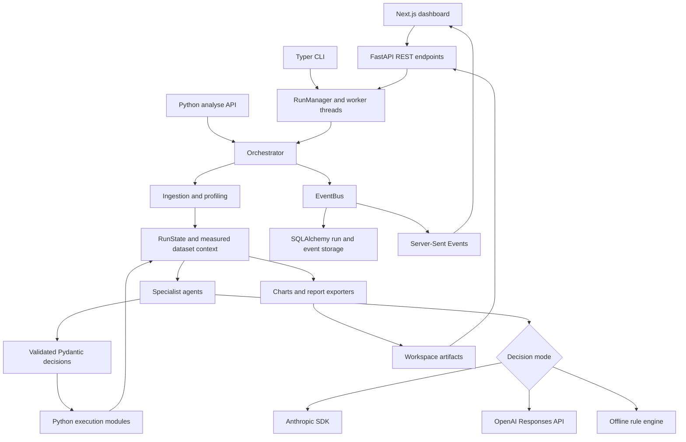

# AI Data Modeler: end-to-end project walkthrough

This guide explains the implementation in this repository, how to demonstrate it,
and how to discuss its design and limitations. Start with the [README](README.md)
for installation. The [frontend README](frontend/README.md) covers the dashboard.

## 1. Explain the project in 30 seconds

> AI Data Modeler takes a tabular dataset through an automated machine-learning
> analysis. It profiles the data, proposes a problem and a plan, cleans and
> transforms features, compares models, optionally tunes the best candidate,
> evaluates the result, and produces an explanatory report. Specialist agents
> make structured decisions with written rationales. Python libraries compute the
> statistics and train the models. A web dashboard exposes the progress, decisions,
> scores, and artifacts. An offline rule engine supports demonstrations without
> making paid model calls.

The project is an AutoML analysis tool. "Data modeler" here means building
predictive models from data; it does not mean designing database schemas or ERDs.

## 2. The problem it addresses

A typical tabular ML project repeats several tasks: checking data quality,
identifying the prediction target, selecting a validation strategy, preparing
features, comparing algorithms, interpreting results, and communicating them.
Manual work is flexible but time-consuming. An automated leaderboard alone does
not explain why a feature was dropped or whether the model is useful.

This project combines an automated workflow with a recorded explanation of its
decisions. Its intended output is an analysis that a person can inspect and
challenge: the plans, measurements, warnings, model comparisons, and reports.

Example: a churn analysis can show that a post-cancellation field was flagged as
possible leakage, explain a proposed removal, train a baseline and alternatives,
and expose whether the resulting model meets the evaluation criteria.

## 3. Architecture at a glance



The graph describes the application; the agents are not separate deployed
services. They are Python classes coordinated within the same process.

| Layer | Main files | Responsibility |
| --- | --- | --- |
| User interfaces | `frontend/src/`, `automl_architect/cli.py`, `runner.py` | Collect input and present results |
| HTTP and background runs | `api/routes.py`, `api/schemas.py`, `api/service.py` | Validate requests, start runs, expose status and control |
| Shared contracts | `core/schemas.py`, `core/state.py` | Describe decisions, measurements, configuration, and run state |
| Orchestration | `orchestrator/engine.py`, `graph.py`, `policies.py` | Order steps; apply retries, budgets, approvals, and replanning |
| Reasoning | `agents/`, `core/agent.py`, `core/llm.py`, `core/offline.py` | Produce and validate typed decisions |
| Data and ML | `ingestion/`, `profiling/`, `execution/` | Load tables, measure statistics, transform features, train and score |
| Output and persistence | `reporting/`, `storage/` | Render reports; retain summaries, events, artifacts, and dataset history |

Paths without a prefix in this table are under `automl_architect/`.

## 4. Follow one dataset through the pipeline

### Step 1: submit the dataset and run options

A user selects a file in the dashboard or supplies a path through the CLI or
Python API. Supported connectors are registered in `ingestion/router.py`.
CSV, Parquet, Excel, and JSON are useful local starting points; database and
cloud connectors require the appropriate drivers, configuration, and access.

For a browser upload, `POST /api/upload?filename=...` stores the bytes and returns
a server-side path. The frontend sends that path in `POST /api/runs`, together
with options such as `target_column`, `max_experiments`, and
`time_budget_seconds`. The API responds with HTTP 202 and a `run_id` while work
continues on a background thread.

The upload limit defaults to 256 MiB and is configurable through
`AUTOML_MAX_UPLOAD_BYTES`. Oversized uploads return 413. This bounds uploaded
data; it is not a memory budget for subsequent pandas processing or model fits.

### Step 2: load and profile

The ingestion layer converts the source into a pandas DataFrame. Profiling
computes row and column counts, missingness, duplicates, distributions,
cardinality, inferred column types, associations, and leakage indicators.
Expensive profiling passes may use a sample according to the configured cap.

The result is a `DatasetProfile`. This is measured evidence, not an LLM-generated
description. `core/context.py` renders it into a reusable prompt context, frozen
once per run to support prompt caching. Later agents also receive the relevant
decisions and results available at their step.

### Step 3: understand the table and define the problem

The Dataset Agent describes the likely domain, row meaning, useful columns, and
readiness issues. The Problem Agent proposes the task, target, metric, and related
constraints. An explicitly supplied target reduces ambiguity.

For `examples/churn.csv`, the intended target is `churned`, a binary outcome.
The included `cancellation_tickets` field deliberately provides suspiciously
strong target information so that leakage handling can be demonstrated.

A proposed task is still an interpretation. The user must confirm whether the
target and features make sense for the actual business question.

### Step 4: create and reconcile a plan

The Planner Agent returns an `ExecutionPlan` with steps, dependencies, expected
work, and rationales. The orchestrator reconciles that proposal against the
known steps in `orchestrator/graph.py`; it does not execute arbitrary generated
Python or shell commands.

Dataset memory may contribute evidence from previous runs with similar shapes,
column names, types, missingness, and task characteristics. It is a weighted
structural comparison in `storage/memory.py`, not training of the language model
and not a vector database requirement.

### Step 5: clean the data

The Cleaning Agent returns a `CleaningPlan`. Operations can include handling
missing values, correcting types, removing duplicates, and dropping unsuitable
columns. Each decision contains a rationale. Postprocessing checks column
references, protects the target from inappropriate changes, and marks
destructive operations for approval when that mode is enabled.

The harness records approved operations for `execution/preparation.py` to fit
inside each training/CV pipeline. The raw partitions remain separate; learned
cleaning statistics are reused when transforming validation and prediction rows.

An explanation example, with illustrative wording rather than a promised output:

> The income distribution is skewed, so the proposed missing-value strategy uses
> the median. The rationale references the measured skew and missing fraction.

### Step 6: plan features for the sealed data partitions

The Feature Agent returns a `FeaturePlan`; decisions include the proposed
operation, inputs, rationale, hypothesis, and risk. `PlanPreprocessor` combines
supported cleaning and feature decisions into an unfitted preparation pipeline.

After initial discovery, `execution/splitter.py` creates raw training, validation,
and test partitions, choosing a random, stratified, grouped, or chronological
strategy as applicable. Subsequent planning uses the training profile. The
trainer clones and fits preparation inside each cross-validation fold.

Initial discovery still sees full-table summaries. The final test partition is
sealed from model selection and scored once after selection, but this is not a
fully blind discovery protocol. History-dependent features are excluded until
inference has a defined history contract. See the [harness guide](docs/HARNESS.md).

### Step 7: select and compare models

The Model Selection Agent proposes candidate families, initial parameters,
priorities, and a baseline. `execution/model_zoo.py` maps supported families to
real estimators. Optional packages such as XGBoost, LightGBM, and CatBoost expand
the available choices; a minimal installation still has scikit-learn models.

The Experiment Agent first runs real computations through the trainer, then
adds interpretation. Candidate failures become recorded failed experiments
where possible. The leaderboard includes measured scores and timings. Metric
direction matters: larger ROC AUC is better, while smaller RMSE is better.

The baseline provides a reference for whether the candidate learned useful
signal. A high-looking score without a baseline, validation strategy, and
uncertainty is not enough to justify deployment.

### Step 8: decide whether tuning is worthwhile

The Tuning Agent evaluates the remaining budget and potential benefit and returns
a `TuningDecision`. If enabled and feasible, the tuner searches supported
parameters, then evaluates the resulting candidate comparably with the original.
A worse tuned candidate should not replace a better original model.

Tuning is optional. Disabling it makes a first demonstration faster and easier
to explain. Time limits are checked between work units; they cannot instantly
interrupt every underlying library call.

### Step 9: explain and evaluate the result

The explainability executor computes supported methods such as permutation
importance, partial dependence, and SHAP when available. The Explain Agent
interprets those measurements. Feature importance describes model behavior;
it does not establish that changing a feature will cause an outcome to change.

Evaluation combines measured diagnostics with an agent verdict: generalization,
calibration where relevant, weaknesses, fairness slices for configured
attributes, and a recommended next action. The verdict is an analysis artifact,
not an external deployment certification.

If evaluation recommends a supported retry, the orchestrator can request a
revised plan. The loop is bounded by policies, time, and `max_replans`. It records
the attempts and can restore the earlier model when the later attempt is worse.
Repeated evaluation also increases selection bias; a final untouched external
test set is valuable for a consequential use case.

### Step 10: produce insights, charts, and reports

The Insight Agent translates recorded results into an executive summary,
recommendations, caveats, and possible next experiments. The Visualization Agent
selects chart specifications. Renderers generate the actual charts.

The Report Agent assembles a `FinalReport`. Exporters support Markdown, HTML,
JSON, and optional PDF/PowerPoint output. A failure in an optional exporter is
reported as a warning so that other successful artifacts can still be used.
Check the returned artifact paths to see which formats actually succeeded.

The Q&A agent runs outside the main plan and answers questions from recorded run
evidence. It does not retrain a model to answer a hypothetical question. Offline
Q&A falls back to a run summary rather than providing full question-specific
reasoning.

## 5. The agent roster

There are 13 pipeline specialists plus a separate Q&A agent.

| Agent | Main output | Explain its role as |
| --- | --- | --- |
| Dataset | `DatasetUnderstanding` | What kind of table is this? |
| Problem | `ProblemDefinition` | What should we predict, and how should success be measured? |
| Planner | `ExecutionPlan` | What sequence of supported steps should run? |
| Cleaning | `CleaningPlan` | What data-quality changes are justified? |
| Features | `FeaturePlan` | Which transformations have a plausible purpose? |
| Model Selection | `ModelSelection` | Which families should be compared? |
| Experiment | `ExperimentLog` | What happened in the actual training comparisons? |
| Tuning | `TuningDecision` | Is a parameter search worth the remaining effort? |
| Explain | `ExplainabilityReport` | What drives this model's predictions? |
| Evaluation | `EvaluationVerdict` | How convincing is the result, and what should happen next? |
| Insight | `InsightReport` | What can a business reader take away? |
| Visualization | `VisualizationPlan` | Which charts answer useful questions? |
| Report | `FinalReport` | How should the complete analysis be presented? |
| Q&A | `QuestionAnswer` | What can the recorded evidence answer? |

`BaseAgent` handles the common call/validation/application lifecycle.
`HybridAgent` adds a computation phase before asking for interpretation. Thus an
agent class can call a numerical executor, while the language model itself is
not the source of the numerical result. Details are in [docs/AGENTS.md](docs/AGENTS.md).

## 6. State, events, and persistence

`RunConfig` describes one analysis. `Settings` describes the deployment:
credentials, workspace, database, model configuration, and service limits.
`RunState` is the mutable in-memory object shared by pipeline steps.
`RunSummary` is its serializable result, excluding the in-memory DataFrames and
fitted Python objects.

The `EventBus` emits events for step progress, decisions, metrics, warnings,
approvals, and completion. Sequence numbers provide a per-run resume cursor.
The API streams events using SSE and supports REST replay. The frontend
`useRunStream` hook backfills history, reconnects with the cursor, deduplicates
events, and can fall back to polling when streaming is unavailable.

Typical output layout, depending on requested features and successful steps:

```text
workspace/
  automl_architect.db           default SQLite database
  .checkpoint-key              local checkpoint authentication key
  uploads/                     uploaded source files
  runs/
    run_<id>/
      run_summary.json         saved structured result
      models/                  fitted model artifacts, when written
      checkpoints/             authenticated stage state and manifest
      charts/                  chart JSON, HTML, and optional images
      reports/                 requested report formats
```

The database records run metadata, summaries, events, experiments, and dataset
history. The filesystem holds larger artifacts and signed checkpoints. Use
`amla recover RUN_ID` or **Resume checkpoint** to restore compatible stage state
after a restart. Completed stages are skipped; an interrupted stage reruns.
Recovery preserves elapsed time and budgets and cannot resume an unfinished
estimator fit mid-iteration. Keep the workspace and authentication key together.

## 7. A five-minute demonstration

Complete installation from the README before presenting. Use the synthetic
example, and run offline first so that provider access and paid calls do not
determine whether the demonstration works.

1. **Introduce the input.** Show `examples/churn.csv`, the `churned` target, and
   the deliberately suspicious `cancellation_tickets` feature.
2. **Show the measured facts.** Run
   `amla profile examples/churn.csv --target churned`. Explain that this step
   computes statistics without a language-model call.
3. **Start an analysis.** In a root PowerShell terminal, run
   `amla serve --offline`. In a second terminal, run `npm run dev` from
   `frontend/`, then open `http://localhost:3000`.
4. **Upload and configure.** Upload the churn CSV, enter `churned` as the target,
   choose a small experiment count, and disable tuning for a short first run.
5. **Follow the decisions.** Show the plan, one cleaning rationale, one feature
   rationale, and the live event feed. Explain that `[rule]` marks offline
   decisions.
6. **Read the result critically.** Compare the winner with the baseline, inspect
   the evaluation and warnings, then open the report and artifacts.
7. **Finish with the boundary.** The system produces an inspectable analysis;
   production use still needs independent validation and operational controls.

Five minutes is a presentation outline, not a promised runtime. Prepare a
completed run before the session so you can inspect its report while a new run
executes. Scores and timings should come from the actual displayed run.

## 8. A concise technical presentation script

> The central design separates reasoning from computation. I represent decisions
> as Pydantic models, with rationale fields and explicit operations. The
> orchestrator reconciles an agent's plan against the supported workflow, and
> Python executors carry out the transformations and model training.
>
> The same mutable run state connects the stages. A serializable summary and an
> ordered event log make the results inspectable through the CLI and web UI.
> The frontend uses REST for commands and snapshots, and SSE for live progress.
>
> Optional steps can degrade into warnings. Evaluation can request a bounded
> second attempt, while the orchestration policy controls retries and approvals.
> Offline mode substitutes deterministic rules for language-model decisions and
> keeps the computational pipeline running, which is useful for tests and demos.
>
> The current implementation is a single-machine prototype. Its strongest claim
> is visibility into the analysis process, rather than guaranteed model quality.
> My next priorities would be stricter isolation of every learned transformation,
> a raw-input inference artifact, and durable job execution.

Adapt first-person claims to the work you actually performed. It is reasonable
to explain that Claude Code helped implement the project and then distinguish
the design decisions, validation, and changes you can personally explain.

## 9. Questions you should be ready to answer

**Why several agents instead of one large prompt?** Each stage has different
inputs and an output contract. Splitting the tasks makes grounding checks,
retries, testing, and explanations easier to associate with the decision they
govern. It also adds latency and orchestration complexity.

**Why Pydantic?** It validates structured output and gives the executor a known
shape. Required rationale fields ensure explanations are present. They do not
prove that those explanations are correct or complete.

**Why SSE instead of WebSockets?** Progress mainly travels from server to
browser. REST handles commands and SSE carries the event stream. Sequence-based
replay supports reconnection without requiring bidirectional socket messaging.

**Is this a RAG system?** Agents receive measured run context and can consult
stored dataset-history suggestions. The repository does not require a vector
store or a general document retrieval pipeline.

**Does it improve itself?** A run can replan based on evaluation, and later runs
can consult stored history. It does not update the language model's weights or
autonomously rewrite its own source code.

**Can it deploy a model?** It writes artifacts and deployment recommendations.
There is no implemented production prediction service, promotion workflow,
monitoring service, or scheduled retraining system.

**How is it tested?** The tests check schemas, ingestion, profiling, execution,
agents, orchestration, reporting, and API behavior. Most use fake LLM output or
the offline rule engine. Those tests verify application behavior; they do not
establish the quality of live model reasoning.

**What did this maintenance update fix?** The root `runs/` ignore rule now
applies only to the root artifact directory, allowing the dashboard's run and
report route files to be included in Git. Dotenv credentials and gateway URLs
are explicitly passed to the SDK, with credentials excluded from settings
serialization. Uploads have a configurable size limit, and regression tests
exercise credentials, boundary sizes, both multipart paths, and byte fidelity.
The CLI now also accepts `serve --offline` and `doctor --offline`. The local
editable installation was refreshed after it was found to reference the old
project directory; the README explains how to repair this after moving a checkout.

## 10. Current limitations and next improvements

| Current boundary | Why it matters | Useful next work |
| --- | --- | --- |
| Initial discovery sees full-table summaries | The complete process is not a fully blind evaluation protocol | Add external holdouts or nested validation for consequential comparisons |
| Replanning repeatedly uses validation scores | Selection can overfit validation despite a separate final test score | Evaluate on more datasets and limit adaptive comparisons |
| Exported pipelines require matching raw columns and compatible libraries | Deployment needs more than loading a model file | Add a versioned inference service and schema monitoring |
| Recovery is explicit and local | Multiple workers lack shared scheduling and run-control state | Introduce a durable job queue and distributed ownership |
| Owner-token access has no tenant isolation | An authorized owner can read files visible to the server | Add per-user workspaces and quotas before multi-user deployment |
| Training is isolated; other stages check deadlines between operations | Profiling or report generation can overrun | Extend supervision and resource limits to other expensive operations |
| Model dropdowns are curated and connection tests verify access | Provider availability and request compatibility can change | Maintain provider capability checks and opt-in live evaluations |
| Dollar costs use operator-supplied estimates | Cache pricing, service tiers, and discounts can differ from billing | Add pricing metadata and reconciliation against actual usage |
| Offline reasoning is heuristic | Domain understanding and Q&A are weaker | Evaluate live and offline decisions on a curated suite of datasets |

Do not present a required rationale as proof of correctness, a feature attribution
as a causal finding, or one synthetic run as a benchmark result.

## 11. Source-reading order

For a technical walkthrough, follow these files in order:

1. [`core/schemas.py`](automl_architect/core/schemas.py): the inputs and outputs.
2. [`runner.py`](automl_architect/runner.py): the public Python entry points.
3. [`orchestrator/engine.py`](automl_architect/orchestrator/engine.py): the run lifecycle.
4. [`core/agent.py`](automl_architect/core/agent.py): the common agent contract.
5. [`agents/cleaning.py`](automl_architect/agents/cleaning.py) and
   [`execution/cleaning_ops.py`](automl_architect/execution/cleaning_ops.py): one decision-to-action example.
6. [`execution/trainer.py`](automl_architect/execution/trainer.py): real fitting and scoring.
7. [`api/routes.py`](automl_architect/api/routes.py) and
   [`frontend/src/hooks/useRunStream.ts`](frontend/src/hooks/useRunStream.ts): the live UI connection.
8. [`reporting/writer.py`](automl_architect/reporting/writer.py): the final deliverables.

For deeper references, see [Architecture](docs/ARCHITECTURE.md),
[API](docs/API.md), and [Deployment](docs/DEPLOYMENT.md).
