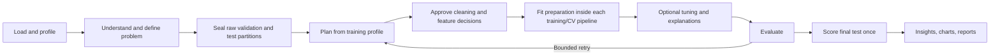

# AI Data Modeler

An automated tabular machine-learning analysis tool with a Python backend and a Next.js dashboard. Give it a dataset and it profiles the data, proposes an analysis plan, prepares features, compares models, optionally tunes a candidate, evaluates the result, and writes reports with recorded decision rationales.

**Claude or GPT reasons; Python computes.** Specialist agents return typed decisions. Pandas, scikit-learn, and optional ML libraries produce the measurements and fitted models. An offline rule engine supports complete local analyses without paid language-model calls.

The [agent harness](docs/HARNESS.md) adds Claude/OpenAI connections, per-run limits, authenticated checkpoints, recoverable execution, fold-local preprocessing, and repeatable evaluations. The dashboard provides provider-specific model dropdowns and verifies access before creating a connection.

For a presentation or interview, read the separate **[end-to-end project walkthrough](PROJECT_WALKTHROUGH.md)**. It includes the architecture, every pipeline stage, a demo script, common questions, and current limitations.

## What you can do

- Analyze CSV, Parquet, Excel, and JSON tables, or configure database, REST, cloud-storage, and Kaggle connectors.
- Run binary/multiclass classification, regression, basic forecasting, clustering, and anomaly-detection workflows. Support varies by task and installed libraries; tabular supervised learning is the main use case.
- Inspect cleaning and feature plans, baselines, leaderboards, explanations, evaluation verdicts, and warnings.
- Follow progress in the CLI or dashboard, and optionally require approval before destructive transformations.
- Export Markdown, HTML, and JSON; add optional dependencies for PDF, PowerPoint, SHAP, boosting, tuning, and static chart images.
- Reuse persisted run history and ask questions about recorded results.

This is a predictive-model analysis project, not a database-schema/ERD designer or a complete production ML platform.

## Harness reliability

| Capability | Implemented behavior |
| --- | --- |
| Provider connections | Bring your own Anthropic or OpenAI API key; choose a model from the dashboard dropdown; retain the server's configured default |
| Typed decisions | Validate agent output against Pydantic contracts and supported execution steps |
| Execution limits | Bound model calls, reserved tokens, optional estimated spending, and training time; cancel training in a supervised child process |
| Validation boundaries | Fit learned preparation inside training/CV pipelines and score the selected model on the final test partition once |
| Recovery | Authenticate local checkpoints, check code/environment compatibility, and resume interrupted runs from completed stages |
| Inspectable runs | Record ordered events, provider/model, usage, decisions, warnings, validation scores, final test scores, and artifacts |
| Repeatable checks | Run offline evaluations on three synthetic datasets and backend/frontend checks in GitHub Actions |

See [the harness guide](docs/HARNESS.md) for the exact guarantees and limitations, and [the changelog](CHANGELOG.md) for the changes included in this work.

## Quick start on Windows

Run these commands in PowerShell. Python 3.11+ is required. The frontend uses Next.js 16, whose documented minimum is Node.js 20.9. Node 22 or 24 matches this project's deployment/development setup. See [Next.js installation requirements](https://nextjs.org/docs/app/getting-started/installation).

### 1. Install the backend

```powershell
git clone https://github.com/EdwardLai32/AI-Data-Modeler.git
cd AI-Data-Modeler
py -3.11 -m venv .venv
.\.venv\Scripts\python.exe -m pip install --upgrade pip
.\.venv\Scripts\python.exe -m pip install -e ".[api,reports,dev]"
```

For an existing checkout, open PowerShell in that folder and skip cloning. If `.venv` already exists and works, reuse it instead of creating it again. Commands below use its executables directly, so PowerShell script activation is not required.

Create a local settings file only if one does not exist:

```powershell
if (-not (Test-Path .env)) { Copy-Item .env.example .env }
```

### 2. Run a first analysis without credentials

```powershell
.\.venv\Scripts\amla.exe doctor --offline
.\.venv\Scripts\amla.exe profile examples/churn.csv --target churned
.\.venv\Scripts\amla.exe run examples/churn.csv --target churned --offline --no-tuning --max-experiments 3 --max-rows 1000 --time-budget 300 --format md,html,json --plain
```

The run prints its status, results, warnings, and artifact paths. Persisted output is under `workspace/runs/<run_id>/`. Training and tuning run in a separate process that can be stopped at the deadline. Other stages check time between steps; profiling and report exports can overrun a deadline.

### 3. Start the dashboard

In a root PowerShell terminal:

```powershell
.\.venv\Scripts\amla.exe serve --offline
```

In another terminal opened at the repository root:

```powershell
cd frontend
npm.cmd ci
npm.cmd run dev
```

Open **http://localhost:3000**. Upload `examples/churn.csv`, choose `churned` as the target, and start an analysis. The API is at http://127.0.0.1:8000; its interactive reference is at http://127.0.0.1:8000/docs.

Use `localhost:3000` for the dashboard with the default CORS settings. If you use another browser origin, add that exact origin to `AUTOML_CORS_ORIGINS`.

### 4. Connect your own Claude or GPT model

1. Expand **Connect your AI** in the dashboard.
2. Choose **Claude (Anthropic)** or **GPT (OpenAI)**. The **Model** dropdown updates for that provider and selects its configured server default.
3. Select a model and enter your provider API key. If you want a dollar limit, also enter the input/output prices under **Cost estimates**.
4. Click **Connect and test**, then start an analysis. This works even when the server started with `--offline`.

The model list is curated, not an account inventory. The connection test makes a small billed request to verify that your key can use the selected model. A ChatGPT or Claude chat subscription does not supply an API key. A custom model configured in the server settings is also included in the dropdown.

Keys are held in server memory, excluded from saved runs and reports, and cleared from the form after connection. Connections expire after one hour; reconnect after a page reload or server restart. **Disconnect** prevents future requests through that connection. See [connection details](docs/HARNESS.md#connect-claude-or-gpt).

### macOS or Linux

From a checkout, use an activated environment:

```bash
python3 -m venv .venv
source .venv/bin/activate
python -m pip install -e ".[api,reports,dev]"
amla run examples/churn.csv --target churned --offline --no-tuning --max-experiments 3
amla serve --offline
# In a second terminal: cd frontend && npm ci && npm run dev
```

## Online and offline reasoning

Offline mode replaces agent decisions with deterministic rules. Real profiling, feature processing, training, scoring, and supported report generation still run. Rule-derived explanations are marked `[rule]`. Offline Q&A provides a summary fallback rather than full question-specific reasoning.

Connect through the dashboard even when the server default is offline, or configure a server-owned connection in `.env`:

```dotenv
ANTHROPIC_API_KEY=your-key-here
AUTOML_PROVIDER=anthropic
AUTOML_OFFLINE=false
```

Start the API or CLI without `--offline`. `ANTHROPIC_AUTH_TOKEN` and `ANTHROPIC_BASE_URL` can also be loaded from dotenv files for compatible setups. Credentials are passed explicitly to the SDK and excluded from settings serialization. Keep `.env` local; Git ignores it.

For GPT, set `AUTOML_PROVIDER=openai`, `OPENAI_API_KEY`, and `AUTOML_MODEL` to a model ID available to your account (the OpenAI default is `gpt-4.1-mini`). The adapter uses the Responses API with structured output and `store=False`. Claude retains the existing `claude-opus-5` default and Anthropic reasoning options; automatic model fallback is off. Choose a model that supports these request options. `amla doctor` checks local readiness; the dashboard connection test checks an actual provider request. Live provider access is not verified by the offline tests.

## How the pipeline works



Thirteen pipeline agents plus a separate Q&A agent operate through Pydantic contracts. The orchestrator reconciles proposed plans with supported steps and controls retries, approvals, budgets, and replanning. Python executors perform computations; hybrid agents add prose to measured results.

The API coordinates analyses on worker threads and executes training/tuning in child processes. Run summaries and ordered events are stored through SQLAlchemy, using SQLite by default. Signed checkpoints and fitted pipelines live in the workspace. The dashboard uses REST for commands and snapshots, and Server-Sent Events with sequence-based replay for progress.

Read the [walkthrough](PROJECT_WALKTHROUGH.md) for each stage and the [architecture reference](docs/ARCHITECTURE.md) for implementation details.

## Python API

```python
from automl_architect import AutoMLArchitect, RunStatus, Settings

architect = AutoMLArchitect(settings=Settings(offline=True))
summary = architect.analyse(
    "examples/churn.csv",
    target="churned",
    project="churn-demo",
    max_rows=1000,
    max_experiments=3,
    time_budget_seconds=300,
    enable_tuning=False,
    enable_explainability=False,
    enable_self_improvement=False,
    report_formats=["markdown", "html", "json"],
)

print(summary.run_id, summary.status)
if summary.status == RunStatus.COMPLETED and summary.report:
    print(summary.report.executive_summary)
else:
    print(summary.error or "Inspect the run's status and pending approvals.")
print(summary.warnings)
```

`analyse` and `analyze` are aliases. Inputs may also be a pandas DataFrame or an explicit `DataSource`. With `require_approval=True`, inspect a paused run and call `architect.resume(request_id, approved, note)` on the same instance.

## Configuration

Deployment settings come from `Settings`: explicit constructor arguments take priority, followed by process environment, `.env.local`, `.env`, then defaults. Dotenv paths are relative to the working directory; launch the backend from the repository root. See [.env.example](.env.example).

| Setting | Default | Purpose |
| --- | --- | --- |
| `AUTOML_OFFLINE` | `false` | Use rules without LLM calls |
| `AUTOML_PROVIDER` | `anthropic` | Server default provider: `anthropic` or `openai` |
| `AUTOML_MODEL` | `claude-opus-5` | Configured provider model ID |
| `AUTOML_OPENAI_MODEL` | `gpt-4.1-mini` | OpenAI default when no explicit OpenAI model override is supplied |
| `AUTOML_API_TOKEN` | Empty | Required owner token for remote API access |
| `AUTOML_ALLOW_REMOTE_SOURCES` | `false` | Permit remote source URIs for the authorized owner |
| `AUTOML_ENABLE_CHECKPOINTS` | `true` | Save authenticated local recovery checkpoints |
| `AUTOML_WORKSPACE` | `./workspace` | Runs, uploads, artifacts, and default database |
| `AUTOML_DATABASE_URL` | Empty | Empty selects SQLite under the workspace |
| `AUTOML_API_HOST` / `AUTOML_API_PORT` | `127.0.0.1` / `8000` | Backend listener |
| `AUTOML_CORS_ORIGINS` | `["http://localhost:3000"]` | Allowed browser origins |
| `AUTOML_MAX_UPLOAD_BYTES` | `268435456` | 256 MiB dataset upload limit |
| `AUTOML_N_JOBS` | `-1` | Estimator parallelism; reduce for constrained machines |
| `AUTOML_MAX_PROFILE_ROWS` | `250000` | Cap for expensive profiling passes |
| `AUTOML_MAX_TRAIN_ROWS` | `500000` | Training sampling cap |
| `AUTOML_CACHE_TTL` | `1h` | Cached prompt-prefix lifetime |

Per-run choices live on `RunConfig`: target, metric override, experiment count, sample cap, split sizes, CV folds, random seed, tuning, explanations, replans, approval mode, report formats, and fairness attributes. Harness defaults are 40 model calls and 500,000 reserved tokens per run, with no dollar cap unless supplied. A dollar cap requires both `AUTOML_INPUT_PRICE_PER_MILLION` and `AUTOML_OUTPUT_PRICE_PER_MILLION`, or rates entered in the connection form. HTTP field names are documented in [docs/API.md](docs/API.md).

Native multipart parsing spools files before checking their size and reading a bounded payload into memory. Raw uploads are checked as their bytes arrive. The fallback multipart parser counts the complete form, including overhead, against the same cap. Large server-side datasets can be supplied by URI instead.

## Optional dependencies

Install capabilities with `python -m pip install -e ".[extra]"`.

| Extra | Adds |
| --- | --- |
| `api` | FastAPI, Uvicorn, SSE, HTTP client, multipart support |
| `reports` | PDF, PowerPoint, Markdown rendering dependencies |
| `boost` | XGBoost, LightGBM, CatBoost |
| `tuning` | Optuna |
| `explain` | SHAP |
| `charts` | Kaleido for static Plotly exports; a compatible browser may be needed |
| `sql`, `snowflake`, `databricks` | Additional database drivers |
| `cloud`, `kaggle` | Remote data connectors |
| `dev` | pytest, coverage, Ruff, mypy |

The `all` extra has a specific subset listed in `pyproject.toml`; it does not include every separately named extra. Install specialized drivers explicitly.

## Example datasets

| File | Target | Demonstrates |
| --- | --- | --- |
| `examples/churn.csv` | `churned` | Binary classification, missing values, deliberate leakage |
| `examples/house_prices.csv` | `sale_price` | Regression |
| `examples/sales_timeseries.csv` | `units_sold` | Basic forecasting |

Examples are synthetic and tracked in Git. Regenerate them with `python examples/generate_datasets.py` when needed. Their scores are demonstration results, not benchmark claims.

## Development and verification

From the root:

```powershell
.\.venv\Scripts\python.exe -m pytest -m "not live and not slow"
.\.venv\Scripts\python.exe -m pytest -m "not live"
.\.venv\Scripts\python.exe -m pytest tests/test_config.py tests/test_uploads.py
.\.venv\Scripts\amla.exe evaluate --provider offline --rows 300 --output artifacts/evaluations/offline.json
```

The first command is a faster check; the second includes slower integration tests. Tests use fake LLM output or offline rules. Missing optional dependencies can cause skips. Live tests require separate opt-in.

From `frontend/`:

```powershell
npm.cmd ci
npm.cmd run typecheck
npm.cmd run build
```

A successful build should include `/runs/[runId]` and `/runs/[runId]/report`. Those source routes must remain visible to Git: the root `.gitignore` uses `/runs/` to ignore only root-level runtime artifacts.

The [CI workflow](.github/workflows/ci.yml) runs backend tests, an offline evaluation, TypeScript checks, and a production frontend build on pushes and pull requests. Provider SDK calls are mocked in tests; live provider evaluations require explicit `--live` opt-in. Evaluation reports record dataset hashes, seeds, completion, metrics, usage, timing, and checkpoint presence. Generated reports stay out of Git.

Tests cover provider/model selection, credential redaction, budgets, retries, fold-local preparation, exported prediction pipelines, checkpoint tampering/recovery, cancellation, API access, and upload boundaries. Offline results demonstrate harness behavior; they do not establish live model quality.

### Version control workflow

Develop changes on a feature branch, review the diff, run the checks above, then commit and push that branch:

```powershell
git switch -c feature/describe-the-change
git status --short
git diff --check
git diff
# Stage the files for this change explicitly, for example:
git add README.md CHANGELOG.md
git diff --cached
git commit -m "docs: describe the change"
git push -u origin HEAD
```

Use focused commit messages such as `feat:`, `fix:`, `test:`, and `docs:`. Record user-visible changes in [CHANGELOG.md](CHANGELOG.md), open a pull request against `main`, and review CI before merging. Keep `.env` files, API keys, uploaded datasets, checkpoints, model binaries, generated reports, and dependency/build directories out of commits. Synthetic datasets under `examples/` are intentional tracked fixtures.

### Troubleshooting

| Symptom | Action |
| --- | --- |
| `amla.exe` silently exits after the project folder was moved | Reinstall from the current root with `.\.venv\Scripts\python.exe -m pip install -e ".[api,reports,dev]"`. This refreshes the editable path and command launchers |
| Static PNG charts fail to export | Check the run warning for a Kaleido/browser error. HTML charts and other successful report formats remain available; static export requires a working compatible browser |
| Offline server still reports missing credentials | Use `amla serve --offline` or set `AUTOML_OFFLINE=true`, and restart the backend |
| Dashboard cannot reach the API | Check the API URL, server process, and exact browser origin in `AUTOML_CORS_ORIGINS` |
| Model dropdown says models are unavailable | Check the API connection; use **Server sign-in** if the server requires a token, then **Retry loading models** |
| A selected model fails the connection test | Verify the API key, your account's model access, billing, and provider availability |

## Current boundaries

- **Validation has explicit boundaries.** Learned cleaning and feature statistics are fitted inside training/CV pipelines; model selection does not see the final test score. Initial schema/problem discovery still sees full-table summaries. This is not a claim of fully blind evaluation or causal inference. History-dependent features are excluded until they have an inference history contract.
- **Reasoning is fallible.** Required rationales make decisions visible; they do not prove the interpretation or business recommendation is correct. Feature importance does not establish causality.
- **Recovery is local and explicit.** Resume a compatible checkpoint with `amla recover RUN_ID` or the dashboard. An interrupted stage is rerun; an estimator's unfinished fit cannot resume mid-iteration. Use one API worker; no distributed queue or multi-user isolation is implemented.
- **Exports include fitted preparation.** The saved pipeline accepts the original feature columns. There is no production inference endpoint, drift monitoring, model promotion, or automatic retraining.
- **Cost is estimated.** Dollar limits require operator-supplied input/output prices. Token reservations include retries and retain unknown usage after failed requests. These limits cannot guarantee a provider invoice total.
- **Access is for a trusted owner.** The API rejects remote access without `AUTOML_API_TOKEN`; remote source URIs are disabled by default. An authorized owner can read local files visible to the process. See the deployment guide before sharing it.

## Documentation

| Document | Use it for |
| --- | --- |
| [Project walkthrough](PROJECT_WALKTHROUGH.md) | End-to-end explanation, demonstration, presentation questions |
| [Frontend README](frontend/README.md) | Dashboard setup, routes, data flow, troubleshooting |
| [Agent harness](docs/HARNESS.md) | Provider connections, limits, validation, recovery, evaluations |
| [Changelog](CHANGELOG.md) | User-visible changes and release history |
| [Architecture](docs/ARCHITECTURE.md) | Structure, state, orchestration, extension points |
| [Agents](docs/AGENTS.md) | Agent inputs, outputs, prompts, and guards |
| [API](docs/API.md) | Endpoint contracts |
| [Deployment](docs/DEPLOYMENT.md) | Containers, storage, proxies, and operating constraints |
| [Resume overview](RESUME_OVERVIEW.md) | Existing portfolio material; verify claims against the implementation |

## License metadata

`pyproject.toml` declares MIT. This checkout does not include a standalone `LICENSE` file with a named copyright holder.
